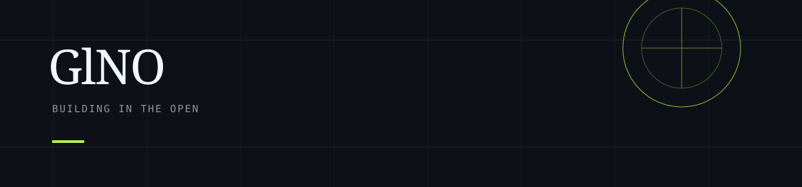

<table>
<tr>
<td bgcolor="#0d1117">

<strong>quiet tools, strange ideas, useful experiments</strong>

</td>
</tr>
</table>

## GlNO

> `add one sentence that sounds like you`

I use this space for small experiments, useful tools, and things I am still figuring out.

### Now

| | |
| --- | --- |
| Learning | `what you are learning` |
| Making | `what you are building` |
| Curious about | `what you want to explore` |

### Work

**[Project name](https://github.com/GlNO)**  
One honest sentence about the problem it solves.

`technology` · `technology`

**[Project name](https://github.com/GlNO)**  
One honest sentence about what you learned while making it.

`technology` · `technology`

### Tools

`language` · `framework` · `database` · `tool`

### Elsewhere

[GitHub](https://github.com/GlNO) · `your link` · `your email`